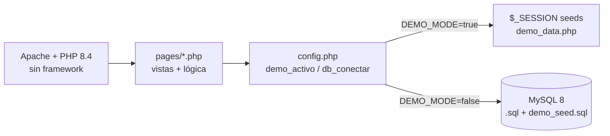

<div align="center">

# 🏠 CRM Inmobiliaria — Gestión de Propiedades, Clientes y Ventas

**CRM clásico en PHP 8.4 + MySQL: propiedades, agentes, clientes, citas, interacciones y transacciones. Con modo demo sin base de datos.**

**Classic PHP + MySQL CRM: properties, agents, clients, appointments, interactions and deals. With zero-database demo mode.**

[](https://www.php.net/)
[](https://www.mysql.com/)
[](https://httpd.apache.org/)
[](https://www.docker.com/)
[](https://render.com/)
[](#-autor-contacto-y-licencia)

**[📦 Repo](https://github.com/FelipeDiazAimar/CRM-Inmobiliaria) · [🇬🇧 English version](README.en.md)**

> Único proyecto del portfolio sin Node: PHP vanilla sin frameworks ni Composer. Ideal para mostrar base sólida (SQL, sesiones, MVC artesanal, Docker).

</div>

> **English TL;DR:** Classic real-estate CRM in vanilla PHP 8.4 + Apache + MySQL: property catalog (houses/apartments/land, USD prices, m², bedrooms, status, images), clients, agents, interactions, appointments and transactions. **Demo mode** (`DEMO_MODE=true`) runs with zero MySQL — in-memory/session seeds (8 clients, 4 agents, 12 properties, 10 interactions, 6 appointments, 6 deals). Real mode with MySQL 8. Deploy on Render via Docker. Full English docs in [README.en.md](README.en.md).

---

## 📑 Tabla de contenidos

1. [Qué es y qué problema resuelve](#-qué-es-y-qué-problema-resuelve)
2. [Demo + credenciales](#-demo--credenciales)
3. [Características](#-características)
4. [Arquitectura](#-arquitectura)
5. [Stack](#-stack)
6. [Estructura](#-estructura)
7. [Quick Start](#-quick-start)
8. [Instalación completa](#-instalación-completa)
9. [Variables de entorno](#-variables-de-entorno)
10. [Guía de uso](#-guía-de-uso)
11. [Base de datos](#-base-de-datos)
12. [Deploy](#-deploy)
13. [Roadmap](#-roadmap)
14. [Troubleshooting](#-troubleshooting)
15. [Autor](#-autor-contacto-y-licencia)

---

## 💡 Qué es y qué problema resuelve

**CRM-Inmobiliaria** es el sistema interno de una inmobiliaria: antes todo era cuadernos y WhatsApps sueltos — propiedades duplicadas, citas olvidadas, nadie sabía en qué estado estaba cada operación. Ahora hay un único lugar con:

| Antes | Ahora |
|---|---|
| Propiedades en fotos sueltas | Catálogo con precio USD, m², dormitorios, estado e imágenes (`IMAGENES`) |
| Clientes en el celular del agente | Ficha de cliente con interacciones y citas asociadas |
| Citas por memoria | Agenda de citas con agente + propiedad + cliente |
| Ventas sin trazabilidad | Transacciones con estado (proceso → cerrada) |
| "¿Quién atendió a este cliente?" | Historial de interacciones por cliente y agente |

---

## 🚀 Demo + credenciales

| Entorno | Cómo |
|---|---|
| 💻 Local demo | `php -S localhost:8000` → http://localhost:8000/pages/index.php |
| ☁️ Render demo | `https://crm-inmobiliaria.onrender.com` (tras Blueprint; plan free se duerme con inactividad, ~1 min en despertar) |

**Contrato demo** (`pages/config.php` + `pages/demo_data.php`):
- `demo_activo()` = true salvo `DEMO_MODE=false`.
- `db_conectar()` lazy: devuelve `null` sin lanzar si MySQL no responde.
- `db_o_demo()` / `db_pdo()` opcionales. En modo real todo intacto.
- Seeds en memoria/sesión: `demo_datos()`, `demo_guardar()`, `demo_escribir()` → 8 clientes, 4 agentes, **12 propiedades** (casas/deptos/terrenos, USD, m², dormitorios, estado), 10 interacciones, 6 citas, 6 transacciones. Datos de ejemplo de El Salvador (Col. Escalón, San Benito, Santa Tecla).
- En demo NADA exige MySQL; los cambios viven solo en `$_SESSION`.

**Credenciales:** no hay login — acceso directo (demo y real).

---

## ✨ Características

| Módulo | Qué hace | Archivo |
|---|---|---|
| 🏠 Propiedades | Alta/baja/modificación, filtros, galería de imágenes | `propiedades.php`, `pages/propiedades.php` |
| 👥 Clientes | Fichas con datos, ciudad, DNI | `pages/clientes.php` |
| 🧑‍💼 Agentes | Plantel con matrícula y fecha de ingreso | `pages/agentes.php` |
| 💬 Interacciones | Llamadas, visitas, seguimientos por cliente | `interacciones.php`, `pages/interacciones.php` |
| 📅 Citas | Agenda agente–cliente–propiedad | `pages/` |
| 💰 Transacciones | Operaciones con estado y monto | `pages/` |
| 🏠 Inicio | Dashboard/resumen | `inicio.php`, `pages/inicio.php`, `pages/index.php` |
| 🎨 UI | Sidebar común, estilos propios, assets | `pages/sidebar.php`, `estilos/`, `assets/`, `image/`, `public/` |

---

## 🏗️ Arquitectura



Sin Composer, sin ORM: `mysqli` + `PDO` directos, sesiones nativas, `.htaccess` con rewrite, `index.php` raíz que redirige a `/pages/index.php`.

---

## 🛠️ Stack

| Capa | Tecnología | Versión / Nota |
|---|---|---|
| Lenguaje | PHP vanilla | `8.4` (sin framework, sin Composer) |
| Servidor | Apache | `2.4` (`php:8.4-apache`, mod rewrite + headers) |
| DB real | MySQL / MariaDB | `8` / `10.4+`, `utf8mb4`, InnoDB |
| Extensiones | `mysqli`, `pdo`, `pdo_mysql` | instaladas en el Dockerfile |
| Demo | `$_SESSION` + seeds | `demo_data.php`, sin MySQL |
| Deploy | Docker + Render Blueprint | `Dockerfile`, `render.yaml` (healthcheck `/pages/index.php`) |
| Estilos | CSS propio | `estilos/`, `assets/`, `public/` |

---

## 📁 Estructura

```
CRM-Inmobiliaria/
├── index.php               # redirige a /pages/index.php
├── inicio.php, propiedades.php, interacciones.php  # entradas clásicas
├── pages/
│   ├── index.php, inicio.php, propiedades.php, clientes.php
│   ├── agentes.php, interacciones.php, sidebar.php
│   ├── config.php          # demo_activo(), db_conectar(), db_o_demo()
│   └── demo_data.php       # seeds + helpers de sesión
├── .sql                    # schema + datos base
├── demo_seed.sql           # seed demo para MySQL real
├── .env.example            # DB_* + DEMO_MODE
├── Dockerfile              # php:8.4-apache, escucha $PORT de Render
├── render.yaml             # Blueprint (DEMO_MODE=true, healthcheck)
├── RENDER.md               # guía de deploy A (demo) / B (real)
├── .htaccess, .dockerignore
└── estilos/ assets/ image/ public/
```

---

## ⚡ Quick Start

```bash
git clone https://github.com/FelipeDiazAimar/CRM-Inmobiliaria.git
cd CRM-Inmobiliaria
cp .env.example .env   # asegura DEMO_MODE=true
php -S localhost:8000
# 👉 http://localhost:8000/pages/index.php
```

> Sin MySQL, sin Docker, sin nada más: PHP 8+ alcanza.

---

## 🔧 Instalación completa

**Prerrequisitos demo:** PHP 8+ con sesiones. **Real:** MySQL 8 accesible + PHP con `mysqli/pdo_mysql`.

```bash
# Demo (default)
cp .env.example .env
php -S localhost:8000

# Real con MySQL local
# 1. Crear base y cargar schema + seed:
mysql -u root -p < .sql
mysql -u root -p crm-inmobiliaria < demo_seed.sql
# 2. .env con DEMO_MODE=false + DB_HOST/DB_USER/DB_PASS/DB_NAME/DB_PORT
php -S localhost:8000

# Docker local (igual que Render)
docker build -t crm-inmobiliaria .
docker run -p 8000:8000 -e PORT=8000 -e DEMO_MODE=true crm-inmobiliaria
```

---

## 🔑 Variables de entorno

| Variable | Default | Descripción |
|---|---|---|
| `DEMO_MODE` | `true` | `true` = seeds en sesión, no exige MySQL. `false` = MySQL real |
| `DB_HOST` / `DB_PORT` | `localhost` / `3306` | Host de MySQL |
| `DB_USER` / `DB_PASS` | `root` / *(vacío)* | Credenciales |
| `DB_NAME` | `crm-inmobiliaria` | Base (ver `CREATE DATABASE` en `.sql`) |

---

## 📖 Guía de uso

1. Entrar a `/pages/index.php` → dashboard.
2. **Propiedades:** crear con precio USD, m², dormitorios, estado e imágenes; filtrar y editar.
3. **Clientes/Agentes:** altas y edición; cada cliente acumula interacciones + citas.
4. **Interacciones:** registrar llamada/visita/seguimiento asociado a cliente (y propiedad si aplica).
5. **Citas:** agendar con fecha, agente, cliente y propiedad.
6. **Transacciones:** cargar operación con monto y seguir su estado hasta el cierre.

---

## 🗄️ Base de datos

Schema `.sql` (MySQL 8, `utf8mb4`, normalizado): `CLIENTES`, `AGENTES` (matrícula, ingreso), propiedades + `IMAGENES` (columnas `imagen` y `url`, ambas usadas por el código), interacciones, citas, transacciones. `demo_seed.sql` para datos de prueba en real. En demo el schema no se necesita.

---

## ☁️ Deploy

Ver `RENDER.md`. Resumen:
- **Opción A (demo, 2 min):** push a `main` → Render **New → Blueprint** con el repo → servicio `crm-inmobiliaria` con `DEMO_MODE=true` → abrir la URL (`/pages/inicio.php`, `/pages/propiedades.php`…).
- **Opción B (real):** crear MySQL afuera (Railway / PlanetScale / Aiven — Render no tiene MySQL gestionado) → cargar `.sql` + `demo_seed.sql` → setear `DB_*` + `DEMO_MODE=false` en el dashboard.
- El `Dockerfile` adapta Apache al `$PORT` de Render; healthcheck en `/pages/index.php`.

---

## 🗺️ Roadmap

- [x] CRUD completo + demo sin MySQL + Docker + Blueprint
- [ ] Login con roles (admin/agente)
- [ ] Subida real de fotos (storage)
- [ ] Filtros avanzados + mapa de propiedades
- [ ] Reportes (ventas por agente/mes)

---

## ❓ Troubleshooting

| Síntoma | Solución |
|---|---|
| Página en blanco | Ver `display_errors` / log de Apache; revisar `.env` |
| `db_conectar()` falla en real | Verificar `DB_*`, puerto y acceso remoto del MySQL |
| Cambios se pierden al reiniciar | Normal en demo (`$_SESSION`); en real usa MySQL |
| Render tarda ~1 min | Plan free dormido; healthcheck lo despierta |
| Imágenes no salen | Revisar columnas `IMAGENES.imagen`/`url` y rutas en `image/` |

---

## 👤 Autor, contacto y licencia

**Felipe Diaz Aimar** — Desarrollo (PHP, MySQL, Docker).
- 💼 LinkedIn: https://www.linkedin.com/in/felipe-aimar/
- 📧 Email: felipediazaimar@gmail.com
- 🐙 GitHub: https://github.com/FelipeDiazAimar

Privado adaptado a portfolio. Todos los derechos reservados.

[(volver arriba)](#-crm-inmobiliaria--gestión-de-propiedades-clientes-y-ventas)

<details>
<summary><b>🇬🇧 English summary (full version in README.en.md)</b></summary>

Classic real-estate CRM in vanilla PHP 8.4 + Apache + MySQL (no frameworks, no Composer): properties (USD, m², bedrooms, status, images), clients, agents, interactions, appointments, transactions. Demo runs with zero MySQL (`DEMO_MODE=true`, session seeds). Real mode with MySQL 8. Docker + Render Blueprint included.

</details>
